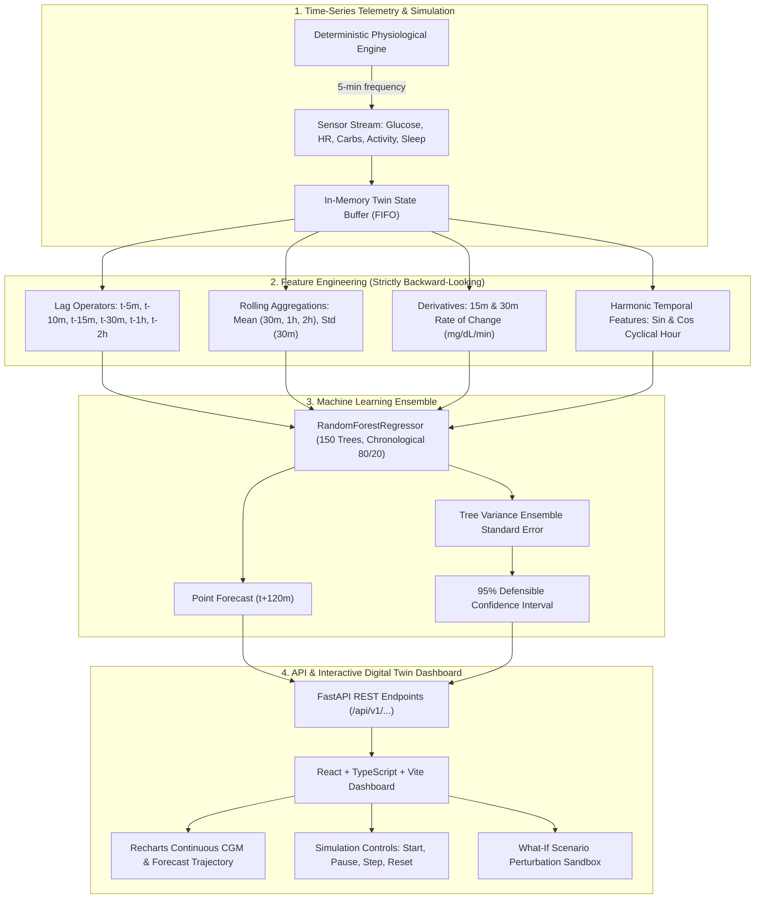

# GlucoTwin AI — Architecture Specification & Technical Blueprint

**Project Title:** GlucoTwin AI — A Time-Series Digital Twin for 2-Hour Glucose Trend Forecasting  
**Challenge:** Digital Twin Challenge 2026 (Unstop)  
**Track:** Healthcare AI & Biomedical Digital Twins  
**Target Horizon:** 120 Minutes Ahead (24 steps @ 5-minute intervals)  
**Safety Status:** Academic & Research Demonstration Only. Not a Medical Device. Non-Diagnostic.

---

## 1. Executive Summary & Problem Context

In glycemic management, individuals experience continuous physiological volatility influenced by carbohydrate consumption, digestive absorption dynamics, physical exertion, and circadian cortisol rhythms. Traditional episodic monitoring leaves patients reactive to excursions.

**GlucoTwin AI** implements a virtual physiological digital twin that continuously ingests time-series telemetry, maintains an in-memory virtual metabolic state, and predicts glucose trends **2 hours (120 minutes) into the future** with defensible ensemble uncertainty estimation.

---

## 2. Four-Tier Architecture Pipeline

### Tier 1: Physiological Simulation & Virtual State Engine
- **Sampling Frequency:** Exactly 5-minute ticks ($\Delta t = 5\text{ min}$).
- **Physiological Modeling:**
  - Circadian baseline oscillation ($24\text{h}$ period).
  - Gastric emptying & carbohydrate digestion absorption curves ($\text{absorption} = \sum \text{carbs} \cdot e^{-\lambda \tau}$).
  - Exercise-induced muscular glucose uptake ($\Delta g \propto -\text{activity}$).
  - Heart rate exertion correlation ($HR = HR_0 + \beta \cdot \text{activity} + \epsilon$).
- **State Buffer:** Maintains chronological sliding window with start/pause/step/reset simulation controls.

### Tier 2: Feature Engineering & Leakage Prevention
To guarantee valid time-series integrity and prevent data leakage:
- **No Lookahead:** All features derived strictly from observations at or prior to $t_0$.
- **Feature Set (23 dimensions):**
  1. `glucose`: Current observed glucose ($y_t$)
  2. `glucose_lag_1` to `glucose_lag_24`: Historic glucose points
  3. `glucose_roc_15m`, `glucose_roc_30m`: First-derivative glycemic velocity
  4. `glucose_roll_mean_6`, `12`, `24`: Moving averages over 30m, 60m, 120m
  5. `glucose_roll_std_6`: Rolling volatility / variance indicator
  6. `sin_hour`, `cos_hour`: Periodic cyclical representation of circadian time
  7. `meal_carbs_sum_12`: Cumulative carbohydrates consumed over the past hour
  8. `activity_mean_6`, `hr_mean_6`: Rolling physical exertion intensity

### Tier 3: ML Ensemble & Uncertainty Quantification
- **Algorithm:** `RandomForestRegressor` with 150 decision trees, maximum depth 14, min_samples_split 4.
- **Prediction Target:** $y_{t+24}$ (glucose 120 minutes ahead).
- **Ensemble Uncertainty:**
  Rather than fabricating arbitrary bounds, uncertainty is calculated from the inter-tree disagreement across all individual tree estimators:
  $$\hat{\sigma}(x) = \sqrt{\frac{1}{B} \sum_{b=1}^B \left( \hat{f}_b(x) - \bar{f}(x) \right)^2}$$
  $$\text{95% Confidence Interval} = \left[ \bar{f}(x) - 1.96 \cdot \hat{\sigma}(x), \, \bar{f}(x) + 1.96 \cdot \hat{\sigma}(x) \right]$$

### Tier 4: Digital Twin Presentation Layer
- **FastAPI Backend:** Fully asynchronous, validated Pydantic v2 schemas, OpenAPI/Swagger interactive documentation (`/docs`), automated CORS.
- **Frontend:** React 18 + TypeScript + Vite + Tailwind CSS + Recharts + Lucide Icons.
- **Controls:** Real-time continuous streaming ticker, stepping by +5m or +30m, instant reset, What-If perturbation sandbox, and theme customization.

---

## 3. Regulatory Scope, Safety & Ethics

1. **Non-Diagnostic Scope:** This project is solely an educational and research proof-of-concept for the Unstop hackathon. It has not undergone clinical trials, FDA 510(k) clearance, or ISO 13485 certification.
2. **No Closed-Loop Insulin Titration:** GlucoTwin AI explicitly prohibits generating automated insulin dosing commands or treatment guidance.
3. **Data Provenance:** Built upon deterministic synthetic physiological sequences. No private protected health information (PHI) is collected or stored.
